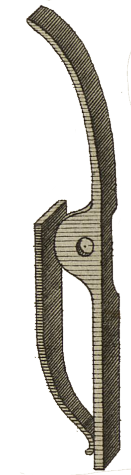

<table>
<tr>
<td></td>
<td align="left">
<h1 style="margin:0">Multibook</h1>

<strong>Lese-Tabs · Mehrere Bücher · KOReader</strong> Plugin · mehrere Stellen · Tab-Leiste

</td>
</tr>
</table>

  
Entwickelt von <a href="https://atelier.atechnologie.fr/">l'Atelier</a> — Buchherstellung und Forschungswerkzeuge (EHESS)

🇫🇷 <a href="README.md">Français</a> ·
🇬🇧 <a href="README.en.md">English</a> ·
🇩🇪 <a href="README.de.md"><b>Deutsch</b></a> ·
🇪🇸 <a href="README.es.md">Español</a>

---

## 📸 Vorschau

| Tabs | Menü |
| :---: | :---: |
|  |  |

## 📖 Über

KOReader-Plugin zum **Lesen mehrerer Bücher** — oder **mehrerer Stellen im selben Buch** — über Tabs. Von l’Atelier.

## ✨ Funktionen

* Tab-Leiste (ein-/ausblenden)
* Neuer Tab **hier** (aktuelle Seite) oder **auf Seite…**
* **Anderes Buch** als Tab öffnen
* Aktiven Tab / andere schließen / Sitzung leeren
* Tab umbenennen, Liste „Alle Tabs…“
* Option: **Tipp am oberen Rand** zeigt die Tabs
* Gesten / Dispatcher: `multibook_toggle_tabs`, `multibook_new_tab_here`, `multibook_new_tab_page`
* Persistente Sitzung (Lesepositionen)

## ⬇️ Installation

1. Plugin-Ordner nach `koreader/plugins/multibook.koplugin/` kopieren  
   (Name **muss** `multibook.koplugin` sein, mit `main.lua`, `_meta.lua`, `session.lua`, `tabbar.lua` im Stamm)
2. KOReader vollständig neu starten
3. Plugin aktivieren: *Einstellungen → Plugin management → User plugins*
4. Menü → **Werkzeuge → Multibook**

## ✏️ Nutzung

| Menüeintrag | Rolle |
|-------------|------|
| **Show tabs** | Zeigt die Tab-Leiste |
| **New tab here** | Tab an der aktuellen Position |
| **New tab at page…** | Tab auf gegebener Seite |
| **Open another book as tab…** | Andere Datei wählen |
| **Close active tab** | Schließt den aktuellen Tab (wenn mehr als einer) |
| **Close other tabs** | Behält nur den aktiven Tab |
| **All tabs…** | Liste / Verwaltung |
| **Clear session** | Entfernt alle Multibook-Tabs |
| **Tap top edge to show tabs** | Tippen am oberen Rand aktivieren |

## 🔗 Ressourcen

| | |
| --- | --- |
| 🌐 **l'Atelier** | [atelier.atechnologie.fr](https://atelier.atechnologie.fr/) |
| 📖 **KOReader** | [github.com/koreader/koreader](https://github.com/koreader/koreader) |

---

🇫🇷 <a href="README.md">Français</a> · <a href="README.en.md">🇬🇧 English</a> · <a href="README.de.md">🇩🇪 Deutsch</a> · <a href="README.es.md">🇪🇸 Español</a> · Multibook — <a href="https://atelier.atechnologie.fr/">l'Atelier</a>

