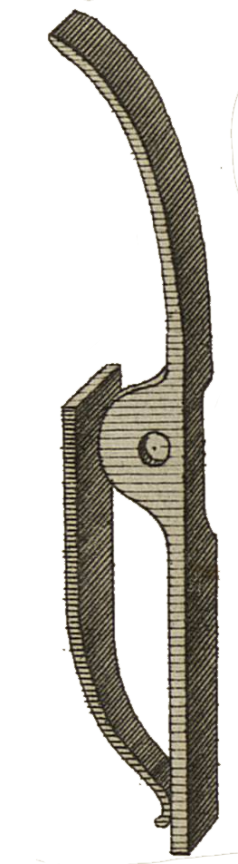

<table>
<tr>
<td></td>
<td align="left">
<h1 style="margin:0">Multibook</h1>

<strong>Reading tabs · Multiple books · KOReader</strong> Plugin · several places · tab bar

</td>
</tr>
</table>

  
Developed by <a href="https://atelier.atechnologie.fr/">l'Atelier</a> — book fabrication and research tools (EHESS)

🇫🇷 <a href="README.md">Français</a> ·
🇬🇧 <a href="README.en.md"><b>English</b></a> ·
🇩🇪 <a href="README.de.md">Deutsch</a> ·
🇪🇸 <a href="README.es.md">Español</a>

---

## 📸 Preview

| Tabs | Menu |
| :---: | :---: |
|  |  |

## 📖 About

KOReader plugin to **read several books** — or **several places in the same book** — via tabs. By l’Atelier.

## ✨ Features

* Tab bar (show / hide)
* New tab **here** (current page) or **at a page…**
* Open **another book** as a tab
* Close active / other tabs / clear session
* Rename a tab, “All tabs…” list
* Option: **tap the top edge** to show tabs
* Gestures / Dispatcher: `multibook_toggle_tabs`, `multibook_new_tab_here`, `multibook_new_tab_page`
* Persisted session (reading positions)

## ⬇️ Installation

1. Copy the plugin folder to `koreader/plugins/multibook.koplugin/`  
   (name **must** be `multibook.koplugin`, with `main.lua`, `_meta.lua`, `session.lua`, `tabbar.lua` at its root)
2. Fully restart KOReader
3. Enable the plugin: *Settings → Plugin management → User plugins*
4. Menu → **Tools → Multibook**

## ✏️ Usage

| Menu item | Role |
|-----------|------|
| **Show tabs** | Shows the tab bar |
| **New tab here** | Tab at the current position |
| **New tab at page…** | Tab at a given page |
| **Open another book as tab…** | Pick another file |
| **Close active tab** | Closes the current tab (if more than one) |
| **Close other tabs** | Keeps only the active tab |
| **All tabs…** | List / manage |
| **Clear session** | Removes all Multibook tabs |
| **Tap top edge to show tabs** | Enables top-edge tap |

## 🔗 Resources

| | |
| --- | --- |
| 🌐 **l'Atelier** | [atelier.atechnologie.fr](https://atelier.atechnologie.fr/) |
| 📖 **KOReader** | [github.com/koreader/koreader](https://github.com/koreader/koreader) |

---

🇫🇷 <a href="README.md">Français</a> · <a href="README.en.md">🇬🇧 English</a> · <a href="README.de.md">🇩🇪 Deutsch</a> · <a href="README.es.md">🇪🇸 Español</a> · Multibook — <a href="https://atelier.atechnologie.fr/">l'Atelier</a>

