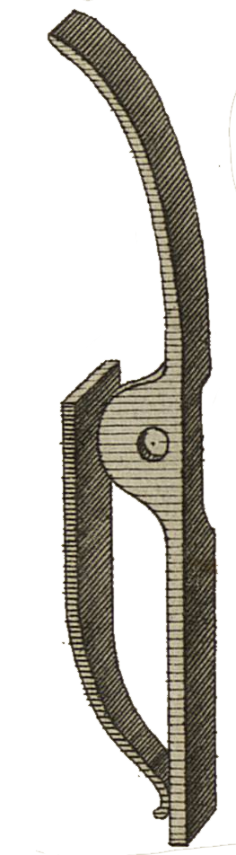

<table>
<tr>
<td></td>
<td align="left">
<h1 style="margin:0">Multibook</h1>

<strong>Pestañas de lectura · Varios libros · KOReader</strong> Plugin · varios lugares · barra de pestañas

</td>
</tr>
</table>

  
Desarrollado por <a href="https://atelier.atechnologie.fr/">l'Atelier</a> — fabricación de libros y herramientas de investigación (EHESS)

🇫🇷 <a href="README.md">Français</a> ·
🇬🇧 <a href="README.en.md">English</a> ·
🇩🇪 <a href="README.de.md">Deutsch</a> ·
🇪🇸 <a href="README.es.md"><b>Español</b></a>

---

## 📸 Vista previa

| Pestañas | Menú |
| :---: | :---: |
|  |  |

## 📖 Acerca de

Plugin KOReader para **leer varios libros** — o **varios lugares del mismo libro** — mediante pestañas. Por l’Atelier.

## ✨ Funciones

* Barra de pestañas (mostrar / ocultar)
* Nueva pestaña **aquí** (página actual) o **en una página…**
* Abrir **otro libro** como pestaña
* Cerrar la pestaña activa / las demás / vaciar la sesión
* Renombrar una pestaña, lista « Todas las pestañas… »
* Opción: **tocar el borde superior** para mostrar las pestañas
* Gestos / Dispatcher: `multibook_toggle_tabs`, `multibook_new_tab_here`, `multibook_new_tab_page`
* Sesión persistente (posiciones de lectura)

## ⬇️ Instalación

1. Copie la carpeta del plugin a `koreader/plugins/multibook.koplugin/`  
   (el nombre **debe** ser `multibook.koplugin`, con `main.lua`, `_meta.lua`, `session.lua`, `tabbar.lua` en la raíz)
2. Reinicie completamente KOReader
3. Active el plugin: *Ajustes → Plugin management → User plugins*
4. Menú → **Herramientas → Multibook**

## ✏️ Uso

| Entrada de menú | Función |
|-----------------|---------|
| **Show tabs** | Muestra la barra de pestañas |
| **New tab here** | Pestaña en la posición actual |
| **New tab at page…** | Pestaña en una página dada |
| **Open another book as tab…** | Elegir otro archivo |
| **Close active tab** | Cierra la pestaña actual (si hay más de una) |
| **Close other tabs** | Conserva solo la pestaña activa |
| **All tabs…** | Lista / gestión |
| **Clear session** | Elimina todas las pestañas Multibook |
| **Tap top edge to show tabs** | Activa el toque en el borde superior |

## 🔗 Recursos

| | |
| --- | --- |
| 🌐 **l'Atelier** | [atelier.atechnologie.fr](https://atelier.atechnologie.fr/) |
| 📖 **KOReader** | [github.com/koreader/koreader](https://github.com/koreader/koreader) |

---

🇫🇷 <a href="README.md">Français</a> · <a href="README.en.md">🇬🇧 English</a> · <a href="README.de.md">🇩🇪 Deutsch</a> · <a href="README.es.md">🇪🇸 Español</a> · Multibook — <a href="https://atelier.atechnologie.fr/">l'Atelier</a>

