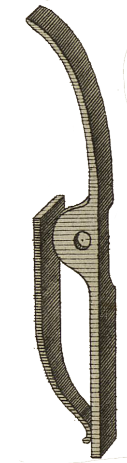

<table>
<tr>
<td></td>
<td align="left">
<h1 style="margin:0">Multibook</h1>

<strong>Onglets de lecture · Plusieurs livres · KOReader</strong> Plugin · plusieurs endroits · barre d’onglets

</td>
</tr>
</table>

  
Développé par <a href="https://atelier.atechnologie.fr/">l'Atelier</a> — fabrication de livres et outils de recherche (EHESS)

🇫🇷 <a href="README.md"><b>Français</b></a> ·
🇬🇧 <a href="README.en.md">English</a> ·
🇩🇪 <a href="README.de.md">Deutsch</a> ·
🇪🇸 <a href="README.es.md">Español</a>

---

## 📸 Aperçu

| Onglets | Menu |
| :---: | :---: |
|  |  |

## 📖 À propos

Plugin KOReader pour **lire plusieurs livres** — ou **plusieurs endroits dans le même livre** — via des onglets. Par l’Atelier.

## ✨ Fonctionnalités

* Barre d’onglets (afficher / masquer)
* Nouvel onglet **ici** (page courante) ou **à une page…**
* Ouvrir **un autre livre** comme onglet
* Fermer l’onglet actif / les autres / vider la session
* Renommer un onglet, liste « Tous les onglets… »
* Option : **tap sur le bord haut** pour afficher les onglets
* Gestes / Dispatcher : `multibook_toggle_tabs`, `multibook_new_tab_here`, `multibook_new_tab_page`
* Session persistée (positions de lecture)

## ⬇️ Installation

1. Copier le dossier du plugin en `koreader/plugins/multibook.koplugin/`  
   (le nom **doit** être `multibook.koplugin`, avec `main.lua`, `_meta.lua`, `session.lua`, `tabbar.lua` à la racine)
2. Redémarrer complètement KOReader
3. Activer le plugin : *Réglages → Plugin management → User plugins*
4. Menu → **Outils → Multibook**

## ✏️ Utilisation

| Entrée de menu | Rôle |
|----------------|------|
| **Show tabs** | Affiche la barre d’onglets |
| **New tab here** | Onglet à la position courante |
| **New tab at page…** | Onglet à une page donnée |
| **Open another book as tab…** | Choisir un autre fichier |
| **Close active tab** | Ferme l’onglet courant (si plus d’un) |
| **Close other tabs** | Garde seulement l’onglet actif |
| **All tabs…** | Liste / gestion |
| **Clear session** | Supprime tous les onglets Multibook |
| **Tap top edge to show tabs** | Active le tap sur le bord haut |

## 🔗 Ressources

| | |
| --- | --- |
| 🌐 **l'Atelier** | [atelier.atechnologie.fr](https://atelier.atechnologie.fr/) |
| 📖 **KOReader** | [github.com/koreader/koreader](https://github.com/koreader/koreader) |

---

🇫🇷 <a href="README.md">Français</a> · <a href="README.en.md">🇬🇧 English</a> · <a href="README.de.md">🇩🇪 Deutsch</a> · <a href="README.es.md">🇪🇸 Español</a> · Multibook — <a href="https://atelier.atechnologie.fr/">l'Atelier</a>

